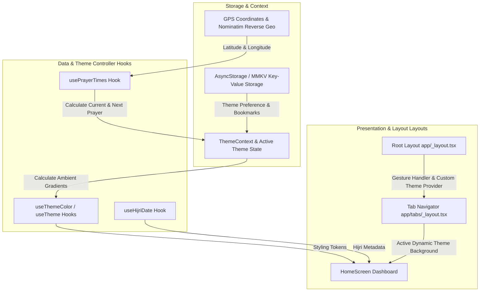

# 🌟 ImanHub — Ultra Design & System Architecture Guide

ImanHub is a premium, high-fidelity Islamic companion application built with **React Native** and **Expo**. This document details the architectural decisions, design tokens, style specifications, and visual guidelines that govern the project.

---

## 🏗️ 1. Architecture & System Topography

The application implements a clean, unidirectional state flow and a decoupled feature-based modular design. Layout and presentation are separated from side-effects and API interactions.

### 🔌 Tech Stack
- **Framework Core:** [Expo SDK 54](https://expo.dev/) & [React Native 0.81.5](https://reactnative.dev/) (TypeScript-first configuration).
- **Navigation Engine:** [Expo Router v6](https://docs.expo.dev/router/introduction/) (File-based navigation with deep-linking & layout inheritance).
- **State Management:** [Zustand](https://github.com/pmndrs/zustand) for reactive state.
- **Persistence Subsystem:** AsyncStorage-backed interface (structured to allow effortless transition to [MMKV](https://github.com/mrousavy/react-native-mmkv) for high-performance memory-mapped synchronous reads).
- **Calculations Core:** `adhan` for astronomical prayer time mathematical calculations and `moment-hijri` for lunar date calendar conversions.
- **Interactive UI & Motion:** [React Native Reanimated](https://docs.swmansion.com/react-native-reanimated/) for high-performance animations, along with [Expo Haptics](https://docs.expo.dev/versions/latest/sdk/haptics/) for tactile sensory feedback.
- **Intelligence Layer:** [Mistral AI client](https://github.com/mistralai/client-ts) (`devstral-2512` & `mistral-small-latest`) for context-aware, respectful conversational guidance.

### 🔄 Unidirectional Data & State Flow


---

## 🎨 2. The Dynamic & Ultra Design System

ImanHub features a signature **dynamic ambient system** that shifts the entire interface color scheme, shadows, and typography based on the solar position (current Islamic prayer phase).

### 🌓 Base Light & Dark Modes
For general screens, settings, and standard list menus, the app uses a clean, high-contrast Zinc-based color palette to prevent visual fatigue:
- **Light Theme Background:** `#F0F2F5` (softer off-white to reduce glare)
- **Dark Theme Background:** `#18181b` (deep Zinc 900)
- **Primary Color Accent:** `#10b981` (emerald green representing growth and nature)

### 🌅 Ambient Prayer Theme Matrix
When viewing prayer times or within dynamic widgets, the interface interpolates style tokens according to the current prayer phase:

| Phase | Theme Vibe | Primary Hex | Background Hex | Card Hex | Border Hex | Gradient Array |
| :--- | :--- | :--- | :--- | :--- | :--- | :--- |
| **Fajr** 🌌 | Cool Dawn Teal | `#4DD0E1` | `#0D1B2A` | `#1B3A4B` | `#1B3A4B` | `['#2C3E50', '#FD746C']` (Deep Navy ➡️ Dawn Pink) |
| **Sunrise** 🌅 | Warm Coral | `#FF7043` | `#1A0F0A` | `#3E2723` | `#4E342E` | `['#2C3E50', '#FD746C']` (Ambient Morning Sunburst) |
| **Dhuhr** ☀️ | Golden Amber | `#FFC107` | `#1C1500` | `#33290A` | `#3D3210` | `['#4FACFE', '#00F2FE']` (Bright Sky Blue ➡️ Teal Cyan) |
| **Asr** 🌤️ | Warm Bronze | `#FFB300` | `#1A1205` | `#2D2210` | `#3D3015` | `['#43C6AC', '#F8FFAE']` (Teal ➡️ Soft Afternoon Gold) |
| **Maghrib** 🌇 | Dusk Plum | `#AB47BC` | `#1A0A1A` | `#311B33` | `#38223C` | `['#f12711', '#f5af19']` (Crimson Sunset ➡️ Amber Gold) |
| **Isha** 🌃 | Midnight Indigo | `#7C4DFF` | `#0A0A1A` | `#1A1A2E` | `#1F1F3A` | `['#0F2027', '#203A43', '#2C5364']` (Deep Void Indigo) |

---

## 🖋️ 3. Typography & Type Scale

ImanHub prioritizes legibility, especially when displaying sacred Arabic texts, using a hybrid typography stack that adapts dynamically to the platform (iOS, Android, Web).

```
   System Font Stack (Sans)             Sacred Quranic Font Stack (Serif)
  ┌─────────────────────────┐          ┌─────────────────────────┐
  │  San Francisco (iOS)    │          │  Amiri-Regular (400)    │
  │  Roboto (Android)       │          │  Amiri-Bold (700)       │
  │  Segoe UI (Web/Desktop) │          │                         │
  └─────────────────────────┘          └─────────────────────────┘
      Used for UI controls,                Used for Quranic verses,
      notifications, and settings           supplications, and counts
```

### 🏷️ Font Configurations
1. **Sacred Texts (Quran / Athkar):**
   - **Regular Serif:** `Amiri-Regular` (Classic Naskh-inspired typography, loaded locally).
   - **Bold Serif:** `Amiri-Bold` (Highly emphasized text, optimal for verses headers and counter displays).
2. **System Interface UI:**
   - **iOS:** `system-ui`, `ui-rounded` (SF Pro Rounded for a modern, soft tactile appearance).
   - **Android:** `sans-serif-medium`, `sans-serif-light` (Roboto variant).
   - **Web:** `"system-ui, -apple-system, BlinkMacSystemFont, 'Segoe UI', Roboto, sans-serif"`.

---

## 📁 4. Architecture Directory Structure

The repository is modularly structured to keep logic, state, hooks, and presentation separated:

```
├── app/                        # Expo Router Navigation Hierarchy
│   ├── (tabs)/                 # Main bottom tabs view controllers
│   │   ├── _layout.tsx         # Bottom navigation styling & tab config
│   │   ├── index.tsx           # Home Dashboard (Hero, Daily Ayah, events)
│   │   ├── prayers.tsx         # Prayer times timeline & calculations tracker
│   │   ├── athkar.tsx          # Athkar list catalog
│   │   └── settings.tsx        # Layout & system configuration settings
│   ├── quran/                  # Sub-routers for the Holy Quran reader views
│   ├── chatbot/                # Mistral AI-driven islamic assistant views
│   ├── _layout.tsx             # Root Layout (Fonts loading, Gesture root, Context)
│   └── index.tsx               # Entry router redirect point
├── components/                 # Atomic design structural components
│   ├── home/                   # Dashboard sub-components (HeroSection, NextPrayerCard)
│   ├── ui/                     # Generic design system components (buttons, badges)
│   └── ...                     # Feature-specific isolated elements
├── constants/                  # Style configuration definitions
│   └── theme.ts                # The base color definitions & dynamic prayer objects
├── context/                    # Context Providers managing global side-effects
│   └── ThemeContext.tsx        # Active theme updates (polled every 60s based on Location)
├── hooks/                      # Custom React Hooks separating logic from visual code
│   ├── useThemeColor.ts        # Dynamically returns correct active theme colors
│   ├── usePrayerTimes.ts       # Location-based calculation wrapper
│   └── useHijriDate.ts         # Wrapper hook transforming Gregorian to Hijri
├── utils/                      # Low-level service managers
│   ├── aiService.ts            # Mistral AI connection and instructions setup
│   ├── storage.ts              # Sync storage wrapper interface
│   └── notifications.ts        # Expo Notification hooks and setups
└── assets/                     # Graphic resources, vectors, and font binaries
```

---

## ✨ 5. UI/UX Interaction & Micro-Animation Guidelines

To achieve an **"Ultra Design"** premium feel, all visual elements must follow these UX specifications:

### 💫 Parallax Scrolling
- The home screen features an animated scroll handler utilizing Reanimated shared values.
- The `HeroSection` interpolates standard scroll positions to decrease opacity and translate the title/prayer card, creating depth when scrolling down:
  $$\text{Scale Ratio} = \text{interpolate}(y_{\text{offset}}, [0, H_{\text{hero}}], [1, 0.95])$$
  $$\text{Opacity} = \text{interpolate}(y_{\text{offset}}, [0, H_{\text{hero}}], [1, 0])$$

### 📳 Tactility & Haptic Feedback
Sensory stimulation matches the spiritual focus of the application:
- **Counters (Athkar increments):** Emit light haptic bumps (`expo-haptics` `ImpactFeedbackStyle.Light`) on successful count increments.
- **Goal Completion:** Emits a notification success haptic response (`NotificationFeedbackType.Success`) when a user completes their daily recitation goal or finished an Athkar set.
- **Buttons / Actions:** Heavy haptics (`ImpactFeedbackStyle.Medium`) are restricted to destructive actions (like clearing bookmarks or resetting counts) to prevent user frustration.

### 🌫️ Glassmorphic Overlays
- Dynamic prayer headers must leverage `expo-blur` with an ambient tint matching the active prayer color scheme.
- Cards should float with subtle shadows and translucent borders:
  - **Light Mode Shadow:** `#000000` with 0.05 opacity, radius 10, offset (0, 4).
  - **Dark Mode Shadow:** `#000000` with 0.25 opacity, radius 15, offset (0, 8).

---

## 🛠️ 6. Code & Styling Best Practices

Developers should write code matching these standards:
1. **Dynamic Theme Retrieval:**
   Always use the `useThemeColor` or `useTheme` hooks rather than hardcoded styles:
   ```typescript
   import { useTheme } from '@/hooks/useThemeColor';
   const theme = useTheme();
   // Style components with theme.text, theme.background, theme.cardBackground
   ```
2. **Layout Adaptability:**
   Always wrap outer views in a `SafeareaContext` container or `SafeAreaView` from `react-native-safe-area-context` to automatically avoid notches, taskbars, and status bars.
3. **Asset Optimization:**
   Use `<Image />` from `expo-image` instead of React Native's default image tag for native disk caching, fading transitions, and vector support.

